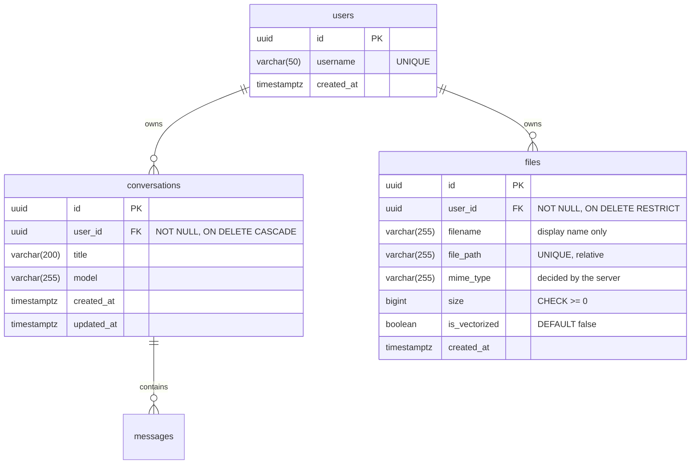

# Private cloud: file storage (v0.5)

This document explains the private cloud of Nuage Libre: how files are
stored, how the data model already supports several users (the "Ghost User"
strategy), the life cycle of a file, the security measures, and **why** each
decision was taken. It complements [ARCHITECTURE.md](ARCHITECTURE.md) (global
architecture) and [DATABASE.md](DATABASE.md) (full data model).

## Table of contents

1. [Scope of v0.5](#1-scope-of-v05)
2. [Data model: the `files` table and the Ghost User](#2-data-model-the-files-table-and-the-ghost-user)
3. [Life cycle of a file](#3-life-cycle-of-a-file)
4. [Security](#4-security)
5. [Design decisions](#5-design-decisions)
6. [The split-screen interface](#6-the-split-screen-interface)
7. [RAG preparation](#7-rag-preparation)
8. [API reference](#8-api-reference)
9. [Operations](#9-operations)
10. [Known limits and next steps](#10-known-limits-and-next-steps)

---

## 1. Scope of v0.5

| Requirement | Delivered |
|---|---|
| Store files on the server's own disk (Bazzite, 2 TB Lexar NVMe) | `POST /api/files`, folder `NUAGE_STORAGE_DIR` |
| List and download / view them | `GET /api/files`, `GET /api/files/{id}/download[?inline=true]` |
| Prepare multi-user (future JWT login) without a later database refactoring | `users` table, `user_id` foreign keys, `get_current_user_id()` dependency |
| Split-screen UI: file manager on the left, chat on the right, 3 view modes | `static/index.html`, `css/files.css`, `js/layout.js`, `js/files.js` |
| RAG preparation: storing ≠ indexing | `files.is_vectorized` (false), inactive "Add to AI memory" button, "RAG context" switch |

**Out of scope on purpose** (documented in §10): deleting or renaming files,
folders, quotas per user, authentication itself, text extraction and
embeddings (RAG).

---

## 2. Data model: the `files` table and the Ghost User

### 2.1 Entity-relationship diagram



### 2.2 The `files` table

Physical model (generated by migration `d8f2b6e1a5c4`):

```sql
CREATE TABLE files (
    id             UUID                     DEFAULT gen_random_uuid() NOT NULL,
    user_id        UUID                     NOT NULL,
    filename       VARCHAR(255)             NOT NULL,
    file_path      VARCHAR(255)             NOT NULL,
    mime_type      VARCHAR(255)             NOT NULL,
    size           BIGINT                   NOT NULL,
    is_vectorized  BOOLEAN                  DEFAULT false NOT NULL,
    created_at     TIMESTAMP WITH TIME ZONE DEFAULT now() NOT NULL,
    PRIMARY KEY (id),
    CONSTRAINT fk_files_user_id_users FOREIGN KEY (user_id) REFERENCES users (id) ON DELETE RESTRICT,
    CONSTRAINT uq_files_file_path UNIQUE (file_path),
    CONSTRAINT ck_files_path_relative CHECK (left(file_path, 1) <> '/' AND strpos(file_path, '..') = 0),
    CONSTRAINT ck_files_size_not_negative CHECK (size >= 0),
    CONSTRAINT ck_files_filename_not_empty CHECK (filename <> '')
);
CREATE INDEX ix_files_user_id_created_at ON files (user_id, created_at);
```

| Column / constraint | Choice | Why |
|---|---|---|
| `id` | UUIDv4, generated **in Python** before the insert | It is also the name of the file on disk, which is written *before* the row (§3). Not guessable in URLs. |
| `user_id` | `NOT NULL` FK, **`ON DELETE RESTRICT`** | A row is a pointer to bytes that PostgreSQL cannot delete. A cascade would silently "forget" files that still occupy the disk; RESTRICT forces the application to delete the bytes first. (Conversations, which are pure database data, use CASCADE.) |
| `filename` | Display name, cleaned (§4.7) | Shown to the user, sent back in `Content-Disposition`. **Never used to build a path.** |
| `file_path` | **Relative** path `"<user_id>/<file_id>"`, `UNIQUE` | Relative: the storage folder can move by changing one setting, and no row can name an arbitrary file of the server. UNIQUE: two rows never share bytes (deleting one cannot destroy another). |
| `ck_files_path_relative` | No leading `/`, no `..` | Path traversal defence **inside the database**: even a hand-written SQL `UPDATE` is refused (test T-SEC-07). `left()`/`strpos()` rather than `LIKE '%..%'` to avoid `%` escaping issues in DDL. |
| `mime_type` | Decided by the server from the extension | The client's declared type is not trusted (§5.5). 255 = RFC 6838 maximum. |
| `size` | `BIGINT`, `CHECK >= 0` | A 32-bit `INTEGER` overflows at 2 GiB, the default upload limit. |
| `is_vectorized` | `BOOLEAN DEFAULT false` | RAG preparation: storing a file and adding it to the AI memory are two different actions (§7). |
| `created_at` | `timestamptz` | UTC in the database, local time in the browser. |
| `ix_files_user_id_created_at` | Composite index | Answers the only listing query, `WHERE user_id = ? ORDER BY created_at DESC LIMIT n`, directly; also serves the foreign key check when a user is deleted (PostgreSQL does not index FKs automatically). |

### 2.3 The Ghost User strategy

**Problem.** Authentication (JWT) is planned for v0.6. Writing single-user
code now would mean, later: adding `user_id` columns to tables full of data,
rewriting every query, and hoping none is forgotten (a forgotten filter is a
data leak between users).

**Solution.** Build the multi-user structure *now*, and plug a placeholder
identity into it:

1. A minimal `users` table exists, with real foreign keys from
   `conversations.user_id` and `files.user_id`. PostgreSQL guarantees that
   every row has a valid owner.
2. Migration `c3e9a1d4b7f2` inserts one row, the **Ghost User**, with a
   hard-coded UUID: `a644871e-8417-4565-91f6-0813f368ff3c` (username `ghost`).
   Existing conversations are given to it by the same migration (backfill).
3. The same UUID is the constant `GHOST_USER_ID` in `app/auth.py`.
4. **One single function decides who the caller is**: the FastAPI dependency
   `get_current_user_id()`. Today it returns `GHOST_USER_ID`. Every route
   declares `user_id: uuid.UUID = Depends(get_current_user_id)` and passes it
   down; every repository query filters on it.

```
              v0.5 (today)                           v0.6 (JWT)
 request ──► get_current_user_id() ──► GHOST     request ──► get_current_user_id() ──► decode JWT
                      │                                               │      (Authorization: Bearer)
                      ▼                                               ▼
     routers ─► services ─► repositories          routers ─► services ─► repositories   (unchanged)
                      │  WHERE user_id = ?                            │  WHERE user_id = ?
                      ▼                                               ▼
                 PostgreSQL                                       PostgreSQL           (unchanged)
```

This is the **seam** pattern: the place where behaviour will change is
isolated behind one interface. When JWT arrives, only `get_current_user_id()`
changes, plus new columns in `users` (`password_hash`...). The tables that
hold the data are not touched.

The seam is already exercised by the tests: `act_as(user_id)` replaces the
dependency exactly as JWT will, and proves that a second user can neither
list, read, continue, delete nor download the Ghost User's data (T-USER-03,
T-USER-04).

**Details that matter**

| Decision | Reason |
|---|---|
| The UUID is copied into the migration, not imported from `app/auth.py` | A migration must replay identically forever (fresh install, restore). Application code keeps changing. Test T-USER-01 checks that both copies are still equal. |
| `user_id` has **no default value** | "Fail closed": code that forgets to say who owns a row gets an error (`NOT NULL` violation, test T-USER-05) instead of silently giving the data to someone. |
| Another user's resource answers **404, not 403** | 403 would confirm that the id exists. With 404, an id of someone else is indistinguishable from a random one (IDOR protection). |
| `get_current_user_id` is `async def` | FastAPI runs plain `def` dependencies in a thread pool: a useless thread hop on every request. |

**Alternatives considered**

| Option | Rejected because |
|---|---|
| No `user_id` until authentication | Large migration on populated tables + rewrite of every query later. |
| `user_id` column without a `users` table / FK | No referential integrity: any UUID could be stored. |
| Nullable `user_id` meaning "single user" | `NULL` is ambiguous, every query needs `IS NULL` special cases, and forgetting the owner goes unnoticed. |
| Full authentication now | Out of the scope of this milestone; the seam makes it a self-contained next step. |

---

## 3. Life cycle of a file

### 3.1 Upload, step by step

```mermaid
sequenceDiagram
    autonumber
    participant U as User
    participant B as Browser (js/files.js)
    participant R as Router (routers/files.py)
    participant S as FileService
    participant D as FileStorage (disk)
    participant DB as PostgreSQL

    U->>B: drops files on the panel (or picks them)
    B->>B: queue: one upload at a time, progress bar per file
    B->>R: POST /api/files<br/>Content-Type: application/octet-stream<br/>Content-Length: N, X-File-Name: percent-encoded name<br/>body = the raw bytes (streamed)
    R->>R: 415 if not octet-stream, 411 if no Content-Length,<br/>422 if the name is not valid percent-encoded UTF-8
    R->>S: upload(user_id, name, request.stream(), declared_size=N)
    S->>S: clean_filename() → 422 if empty
    S->>S: N > NUAGE_MAX_UPLOAD_BYTES → 413 (body never read)
    S->>D: free_bytes() → 507 if N + reserve does not fit
    S->>D: save("<user_id>/<file_id>", chunks ≤ limit)
    D->>D: write ".<file_id>.part" (mode 600) chunk by chunk
    D->>D: fsync(file) → rename to "<file_id>" (atomic) → fsync(folder)
    D-->>S: bytes written
    S->>S: bytes ≠ N → delete, 400 (truncated upload)
    S->>DB: BEGIN; INSERT INTO files ...; COMMIT
    alt INSERT fails
        S->>D: delete the bytes (compensation) → 500 generic message
    end
    S-->>R: StoredFile
    R-->>B: 201 Created + Location + JSON (no file_path)
    B->>U: row appears at the top of the list
```

1. **Browser** (`static/js/files.js`). Files dropped on the panel (or chosen
   with the picker) enter a queue and are sent **one at a time** with
   `XMLHttpRequest`, which, unlike `fetch()`, reports *upload* progress. The
   `File` object is sent as the body: the browser streams it from the disk,
   the page never loads it into memory. The name travels in the
   `X-File-Name` header, percent-encoded (`encodeURIComponent`), because HTTP
   headers are ASCII-only.
2. **Router** (`app/routers/files.py`). Only protocol checks, before reading
   a single byte of the body: media type (415), presence of
   `Content-Length` (411), decoding of the name (422).
3. **Service** (`app/services/file_service.py`). Business rules, still
   before reading the body: the name is cleaned, the announced size is
   compared to the limit (413) and to the free disk space minus a reserve
   (507). A refused upload costs no bandwidth, no disk write, no SQL.
4. **Storage** (`app/repositories/file_storage.py`). The body is streamed
   to `<root>/<user_id>/.<file_id>.part`, created with mode `600` and
   `O_EXCL`. Chunks are grouped into 1 MiB writes executed in a worker
   thread, so the event loop (which also serves the chat streams) is never
   blocked. The size limit is enforced **again** while streaming (defence in
   depth). Then: `fsync` (bytes physically on disk), atomic `rename` to the
   final name, `fsync` of the folder (the rename itself survives a crash).
5. **Database**. Only now is the row inserted, in its own short
   transaction. If it fails, the bytes are deleted again (compensating
   action) and the client gets a generic message; details go to the logs.
6. **Response**. `201 Created`, a `Location` header pointing to the new
   file, and the public representation (`FileOut`) which omits `file_path`
   and `user_id`. The UI inserts the row at the top of the list.

### 3.2 What happens when something fails

| Failure | Where | Result on disk | Result in DB | HTTP |
|---|---|---|---|---|
| Wrong body type (e.g. multipart form) | router | nothing | nothing | 415 |
| No `Content-Length` (chunked body) | router | nothing | nothing | 411 |
| Name not decodable / empty once cleaned | router / service | nothing | nothing | 422 |
| File larger than the limit | service, before reading | nothing | nothing | 413 |
| Not enough free space | service, before reading | nothing | nothing | 507 |
| Client disconnects / cancels mid-upload | storage, while streaming | `.part` deleted | nothing | (400, client gone) |
| Body shorter than announced | service, after streaming | file deleted | nothing | 400 |
| `INSERT` fails (database down, FK...) | service | file deleted (compensation) | rolled back | 500, generic message |
| Server crash between rename and `INSERT` | — | orphan file, invisible | nothing | — (see §10) |

Every line of this table is covered by an automated test (§4 of
[TEST_PLAN.md](TEST_PLAN.md)), and the cancellation of a 400 MB upload at 10 %
was also verified in a real browser.

### 3.3 Download and view

```
GET /api/files/{id}/download            -> Content-Disposition: attachment   (save)
GET /api/files/{id}/download?inline=true -> Content-Disposition: inline     (view, if safe)
```

1. `{id}` is typed `uuid.UUID`: anything else (`../../etc/passwd`,
   `1 OR 1=1`) is rejected with 422 before the code runs.
2. The row is looked up with `WHERE id = ? AND user_id = ?` (404 otherwise).
3. `FileStorage.locate()` resolves the relative path and checks it stays
   inside the storage root (§4.2), and that the bytes exist (404 + error log
   otherwise, e.g. a file deleted by hand through Samba).
4. The service decides **how** the file may be sent: `inline` is granted only
   for types in the safe allow-list; text formats are sent as `text/plain`.
5. `FileResponse` streams the file from disk in chunks (constant memory),
   supports `Range` requests (seeking in a video) and encodes non-ASCII names
   (RFC 6266 / RFC 5987: `filename*=utf-8''donn%C3%A9es.bin`).

---

## 4. Security

### 4.1 Threat model

| Asset | Threat | Actor |
|---|---|---|
| Files of the server outside the cloud (`/etc/shadow`, SSH keys, `.env`) | Path traversal, confused deputy | Malicious client, altered database row |
| The user's session in Nuage Libre | Stored XSS through an uploaded HTML/SVG file | A file received from someone else and uploaded |
| The user's files | Unauthorised read (IDOR), cross-site upload (CSRF) | Another user (v0.6), a malicious website open in the browser |
| Availability of the server (disk, RAM) | Huge or endless uploads | Bug or malicious client |
| Privacy of file names and contents | Logs, browser cache, Referer leaks | Anyone with access to logs / the device |

Access to the application itself is, until v0.6, protected only at the
network level (Tailscale). The measures below do not depend on it.

### 4.2 Path traversal: how the download route cannot reach system files

A path traversal attack tries to make the server read or write a file
outside the intended folder, typically with `../` sequences
(`GET /download?name=../../etc/passwd`). Nuage Libre stacks five independent
layers; **any single one** is enough to stop the classic attack.

| # | Layer | Mechanism | Where | Test |
|---|---|---|---|---|
| 1 | **No user input in paths** | The path on disk is built only from two server-generated UUIDs: `<user_id>/<file_id>`. The user's file name is never part of it. | `FileStorage.relative_path_for()`, `FileService.upload()` | T-FILE-01, T-FILE-04 |
| 2 | **Typed identifiers** | The route parameter is a `uuid.UUID`: `..%2F..%2Fetc%2Fpasswd` or `1 OR 1=1` is rejected (422 / 404) before our code runs. | `routers/files.py` | T-FILE-19 |
| 3 | **Ownership filter** | The file must belong to the caller (`WHERE id = ? AND user_id = ?`). | `FileRepository.get_for_user()` | T-USER-04 |
| 4 | **Database constraint** | `ck_files_path_relative`: no absolute path, no `..`, even through direct SQL. | migration `d8f2b6e1a5c4` | T-SEC-07 |
| 5 | **Containment check** | `(root / path).resolve()` must stay inside `root.resolve()`. `resolve()` normalises `..` and follows symbolic links, so `/etc/passwd`, `../../x` and a symlink planted in the folder are all refused. | `FileStorage.resolve()` | T-STO-01, T-STO-02, T-SEC-08 |

Layer 5 exists for the "confused deputy" scenario: if a database row were
ever altered (bug, manual edit, compromised database), the download route
must still refuse to serve something outside the storage. The mutation test
proves it is not redundant: with the check removed, test T-SEC-08 really
received `/etc/passwd` through a planted symlink.

On the **write** side, files are created with `O_CREAT | O_EXCL` (mode `xb`):
the call fails if the path already exists, including as a symbolic link, so
an upload can never be redirected to overwrite another file.

### 4.3 Stored XSS through uploaded files

If an uploaded `page.html` or `logo.svg` were displayed *inline* from our
origin, its JavaScript would run as if it were Nuage Libre itself: it could
call the API and read or upload files. Defences:

1. **Inline allow-list** (`file_policy.inline_media_type()`): only types that
   cannot run scripts may be viewed: raster images (PNG, JPEG, GIF, WebP,
   AVIF, BMP), PDF, audio, video. **SVG and HTML are never rendered.**
2. **Text is shown, not interpreted**: `text/*` and JSON/XML are served as
   `text/plain` when viewed. `page.html` shows its source code (verified in
   Firefox: `<script>alert(1)</script>` displayed as text, no script run).
3. **`X-Content-Type-Options: nosniff`**: the browser never second-guesses
   the declared type (a text file that looks like HTML stays text).
4. **`Content-Security-Policy: default-src 'none'; …; sandbox`** on every
   response except PDF, audio and video: the document becomes an isolated,
   script-less origin. The built-in viewers are excluded because they may
   refuse to run in a sandboxed document (PDF viewers do), and they gain
   nothing from it: with `nosniff` and a PDF/media type, the bytes can only
   be decoded by that viewer. Verified in Firefox: a PNG renders under the
   sandbox, a PDF renders in pdf.js.
5. Everything else is sent as an **attachment** (download), even when
   `?inline=true` is asked.

The UI never duplicates this rule: the API returns `previewable`, computed
by the server, and the "View" action only appears when it is true.

### 4.4 CSRF: protection by construction

A malicious website open in the same browser could try to upload into the
user's cloud (Cross-Site Request Forgery). Browsers let any site send
"simple" cross-origin requests, such as an HTML form posting
`multipart/form-data`. Our upload protocol is **not** simple: it requires
the custom header `X-File-Name` and the `application/octet-stream` type, so
the browser must first ask the server's permission (CORS preflight), which
Nuage Libre never grants. A multipart upload is refused with 415 (test
T-FILE-07). Downloads add `Cross-Origin-Resource-Policy: same-origin`: other
websites cannot embed our files in an `` or `<video>`.

### 4.5 Access control (IDOR)

Every query is scoped by `user_id` (§2.3). Another user's file or
conversation is answered with 404, exactly like a random id, so the API
never confirms that an id exists. Identifiers are random UUIDv4s (not
enumerable). Tested with a second user (T-USER-03, T-USER-04); the mutation
"remove the ownership filter" is caught by T-USER-04.

### 4.6 Resource exhaustion (availability)

| Measure | Effect |
|---|---|
| `NUAGE_MAX_UPLOAD_BYTES` (2 GiB) checked on `Content-Length` | Refused before a single byte is read (413). Verified in Firefox: the browser receives the 413 message even while still sending. |
| Same limit enforced while streaming | Holds even if the announced size were missing or wrong (T-FILE-13). |
| `Content-Length` required (411) | No upload of unknown, potentially endless, size. |
| `NUAGE_MIN_FREE_DISK_BYTES` reserve (2 GiB) | The cloud can never fill the disk completely (507). |
| Streaming write, 1 MiB buffer | Memory use is constant whatever the file size; nothing goes to `/tmp`, which is RAM on this server (§5.1). |
| Disk I/O in worker threads | A slow disk never freezes the chat streams served by the same event loop. |
| `?limit=` validated (1 – 1000) | The list cannot be asked to return millions of rows. |

### 4.7 File name hygiene

The name is a display value, but it is shown in the UI and sent back in an
HTTP header, so `clean_filename()` (unit-tested, T-POL-01 to 04):

- normalises Unicode to **NFC** (macOS sends decomposed accents, NFD);
- keeps only the last path component (`C:\Users\me\x.pdf` → `x.pdf`);
- removes control characters (CR/LF would allow **header injection** in
  `Content-Disposition`), NUL, line separators;
- removes **bidirectional controls**: `invoice<U+202E>fdp.exe` (U+202E) would
  *display* as `invoiceexe.pdf`;
- refuses empty names, `.` and `..`; shortens names over 255 characters
  while keeping the extension.

In the browser, names are only ever inserted with `textContent`.

### 4.8 Confidentiality on the server and in the browser

- Files `600`, folders `700`: other accounts of the server cannot read them.
- `Cache-Control: no-store`: the browser keeps no copy in its disk cache.
- `Referrer-Policy: no-referrer`: a link clicked inside a viewed PDF does
  not reveal the file's URL to the destination site.
- Logs contain file **ids and sizes, never names** (a name such as
  `medical_results.pdf` is personal data: GDPR data minimisation).
- The name travels in a header rather than in the URL query string, which
  would be written to the access logs.

---

## 5. Design decisions

### 5.1 Upload as a raw body, not `multipart/form-data`

| | `UploadFile` (multipart), FastAPI default | Raw body (chosen) |
|---|---|---|
| Where the bytes go first | Spooled by Starlette into a temporary file under `/tmp` | Directly to the final disk, chunk by chunk |
| On this server | `/tmp` is a **tmpfs** (RAM, 16 GB, measured with `findmnt`), shared with the LLM: a 4 GB video would occupy 4 GB of RAM | Constant memory (≈ 1 MiB per upload) |
| Disk writes | Twice (temporary file, then the final copy) | Once |
| Size limit | Known only after the whole body has been received | Checked on `Content-Length` before reading |
| CSRF | Multipart is a "simple" request any site can submit | Needs a CORS preflight (§4.4) |
| Precedents | HTML forms | Amazon S3 `PutObject`, Google Drive `uploadType=media`, Dropbox `/upload` |
| Cost | — | The name travels in a header (`X-File-Name`, percent-encoded) |

### 5.2 Disk first, database last

The disk and PostgreSQL cannot share a transaction. Writing the bytes first
(atomically) and inserting the row last makes the database the source of
truth: a row only exists once its bytes are durable, so the UI never lists
a file that cannot be downloaded. The opposite order would leave visible,
broken rows after a crash. The remaining risk (a crash between the rename
and the `INSERT`) only leaves an invisible orphan file, which a future
clean-up job can detect. Same philosophy as the chat's "one transaction at
the end of generation" ([ARCHITECTURE.md](ARCHITECTURE.md) §4.3).

### 5.3 UUID file names and a relative `file_path`

Generated names remove a whole class of problems at once: path traversal,
two users uploading `photo.jpg`, names that are invalid on the filesystem,
names that reveal content in a directory listing. Storing the path relative
to the root keeps the database portable (move the folder, change one
setting) and makes "a row pointing at `/etc/shadow`" impossible (CHECK
constraint + containment check).

### 5.4 `ON DELETE RESTRICT` for files, `CASCADE` for conversations

Conversations and messages live entirely in PostgreSQL: deleting a user can
safely cascade (GDPR right to erasure). A `files` row, however, describes
bytes on a disk that PostgreSQL cannot touch: RESTRICT makes the database
refuse to lose track of them (test T-USER-06).

### 5.5 MIME type decided by the server

The `Content-Type` sent by a client is a claim, not a fact. The type is
derived from the extension (`mimetypes`, Python standard library), so it is
predictable and consistent. Security does not rely on it anyway: whatever
the type, the inline allow-list, `nosniff` and the sandbox decide what the
browser may do. Inspecting the content ("magic bytes") would need an extra
native library (libmagic) and is left for the RAG text extraction (v0.7).

### 5.6 Where the files live

Default: `/var/mnt/Lexar2To/data_nuage_libre/cloud_storage` (setting
`NUAGE_STORAGE_DIR`), on the 2 TB data NVMe, in a **dedicated sub-folder**:
the root of `data_nuage_libre/` already holds personal files shared over
Samba, and the application must own its folder entirely. The path must be
absolute (refused at startup otherwise), so the same configuration can
never write to two places depending on the working directory.

---

## 6. The split-screen interface

```
┌──────────── app bar: brand · [ Files | Split | Chat ] · themes ─────────────┐
│ ┌─ files panel (glass) ─────────┐ ┌─ chat panel ─────────────────────────┐ │
│ │ My cloud           [Upload]   │ │ [☰][+] (● model ▾)      [◉ RAG]       │ │
│ │ ┌╌╌ drop zone ╌╌╌╌╌╌╌╌╌╌╌╌┐   │ │                                       │ │
│ │ └╌╌╌╌╌╌╌╌╌╌╌╌╌╌╌╌╌╌╌╌╌╌╌╌┘   │ │        messages (cloud bubbles)       │ │
│ │ PDF  Cours.pdf   👁 ⤓ [AI]    │ │                                       │ │
│ │ PNG  Photo.png   👁 ⤓ [AI]    │ │ ( Ask anything…                   ➤ ) │ │
│ └───────────────────────────────┘ └───────────────────────────────────────┘ │
└──────────────────────────────────────────────────────────────────────────────┘
```

**Layout with CSS only.** The workspace is a CSS grid of two columns whose
widths follow one attribute, `<html data-view>`: `split` → `1fr 1fr`,
`chat` → `0fr 1fr`, `files` → `1fr 0fr`. Browsers animate between `fr`
values, so a panel glides shut while the other grows. JavaScript
(`js/layout.js`) only changes the attribute; the state lives in one place.
While a panel shrinks, its content keeps a minimum width and is clipped
(instead of being squashed into one word per line), and it fades out.

**No flash of the wrong layout.** The inline script in `<head>` that already
applied the saved theme now also applies the saved view, before the first
paint.

**Container queries.** In split-screen, the chat is half a laptop screen or
half a 27-inch monitor: only the width of the *panel* says how much room it
has. Both panels are CSS containers (`container: chat / inline-size`), and
their content adapts with `@container` rules and `cqi` units (1 % of the
panel's width) rather than `@media` (the screen). Example: the conversation
history is a column beside the messages when the chat panel is at least
860 px wide, and a drawer over them otherwise, on any screen.

**Accessibility (RGAA / WCAG).**

- The hidden panel is made `inert`: no focus, no click, removed from the
  accessibility tree (verified: focus cannot enter it).
- The view switcher follows the WAI-ARIA *radio group* pattern (arrow keys,
  roving `tabindex`), like the theme switcher.
- Drag & drop is a mouse-only gesture: the drop zone is also a real button
  opening the file picker; touchscreens read "Tap to add files".
- Upload progress uses `role="progressbar"` with `aria-valuenow`; errors use
  `role="alert"`; "View/Download" have accessible names that include the
  visible label and the file name (WCAG 2.5.3).
- The inactive "Add to AI memory" uses `aria-disabled` (still focusable,
  explains itself when activated) rather than `disabled` (invisible to the
  keyboard).
- The closed history drawer is `visibility: hidden`: Tab no longer walks
  through off-screen links (a gap of the previous version, fixed).
- New colours (`--accent-ink-violet`, `--accent-ink-amber`) and the file
  badges were contrast-checked (≥ 4.5:1 in the three themes).

**Small screens.** Below 900 px, two panels would each be too narrow:
"Split" is not offered and falls back to the chat; the preference is kept
and restored when the window grows again.

---

## 7. RAG preparation

RAG (*Retrieval-Augmented Generation*) lets the model answer using the
user's own documents: their text is split into passages, each passage is
turned into a vector (*embedding*), and at question time the closest
passages are added to the prompt.

**Storing is not indexing.** Uploading a file only stores it. Adding it to
the AI memory will be a separate, explicit action, because embedding costs
GPU time (eco-design) and because the user decides what the AI may read.

| Element | v0.5 (now) | v0.7 (planned) |
|---|---|---|
| `files.is_vectorized` | Always `false` | Set to `true` once the file's chunks are embedded |
| "Add to AI memory" button | Visible, `aria-disabled`, explains itself | Calls `POST /api/files/{id}/vectorize`: extract text → split into chunks → embed with `nomic-embed-text` (Ollama) → store in a `document_chunks` table (`VECTOR(768)`, HNSW index, pgvector) |
| "RAG context" switch | Remembered; status line says honestly that answers do not use documents yet | Sent with each chat message; the server retrieves the closest chunks of the user's vectorized files and cites them |
| File badge | "Cloud only" | "In AI memory" |

Security note for v0.7: document content is untrusted. Retrieved passages
will be treated as *data* in the prompt (prompt injection, OWASP LLM01), and
the model has no tools to act on.

---

## 8. API reference

| Method | Route | Description | Success | Errors |
|---|---|---|---|---|
| `POST` | `/api/files` | Upload one file (raw body) | 201 + `Location` | 400, 411, 413, 415, 422, 500, 507 |
| `GET` | `/api/files?limit=200` | The caller's files, newest first (1–1000) | 200 | 422 |
| `GET` | `/api/files/{id}/download` | Download (attachment) | 200 | 404, 422 |
| `GET` | `/api/files/{id}/download?inline=true` | View in the browser (safe types only) | 200 | 404, 422 |

```bash
# Upload (the name is percent-encoded: "Rapport de stage.pdf")
curl -X POST http://127.0.0.1:8000/api/files \
     -H "Content-Type: application/octet-stream" \
     -H "X-File-Name: Rapport%20de%20stage.pdf" \
     --data-binary @"Rapport de stage.pdf"
```

```json
{
  "id": "eba35e3d-e284-43e5-b765-699bf0462a40",
  "filename": "Rapport de stage.pdf",
  "mime_type": "application/pdf",
  "size": 182734,
  "is_vectorized": false,
  "created_at": "2026-11-12T00:40:21.731Z",
  "previewable": true
}
```

The interactive documentation (`/docs`) shows a file picker for the upload.

---

## 9. Operations

| Variable | Default | Meaning |
|---|---|---|
| `NUAGE_STORAGE_DIR` | `/var/mnt/Lexar2To/data_nuage_libre/cloud_storage` | Where the bytes are stored (absolute path, created on first upload) |
| `NUAGE_MAX_UPLOAD_BYTES` | `2147483648` (2 GiB) | Largest accepted file |
| `NUAGE_MIN_FREE_DISK_BYTES` | `2147483648` (2 GiB) | Free space that must remain after an upload |

**Backup.** The cloud is two things that must be saved together: the
database (`pg_dump`, see [DATABASE.md](DATABASE.md) §7) and the storage
folder (e.g. `rsync -a --delete`). Dump the database **first**: thanks to the
"disk first" order, every row of the dump then has its bytes in the folder
copied afterwards.

**Samba.** The default folder is inside the `NuageLibre` Samba share. Files
there have opaque UUID names and must not be renamed or deleted by hand: the
database would no longer match (a missing file gives a clean 404 and an
error in the logs, test T-FILE-20). For production, the folder can be moved
out of the share (one setting) or hidden with Samba's `veto files`.

---

## 10. Known limits and next steps

| Limit | Planned answer |
|---|---|
| No authentication: access relies on Tailscale | v0.6: JWT in `get_current_user_id()`, Argon2 password hashes in `users` |
| No delete / rename of files | `DELETE /api/files/{id}` (bytes then row, same compensation logic) |
| Possible orphan files after a crash between rename and `INSERT` | Clean-up job comparing the folder with the table |
| No quota per user | Sum of `files.size` per user checked in `FileService.upload()` |
| No integrity hash | SHA-256 computed while streaming (also enables deduplication) |
| No antivirus scan | ClamAV (local) before indexing, if files are shared between users |
| Inline audio/video under the browsers' native players not verified in an automated browser (the headless Firefox used for E2E does not open audio documents at all, even without any security header) | Manual check in desktop Firefox / Safari / Chrome |
