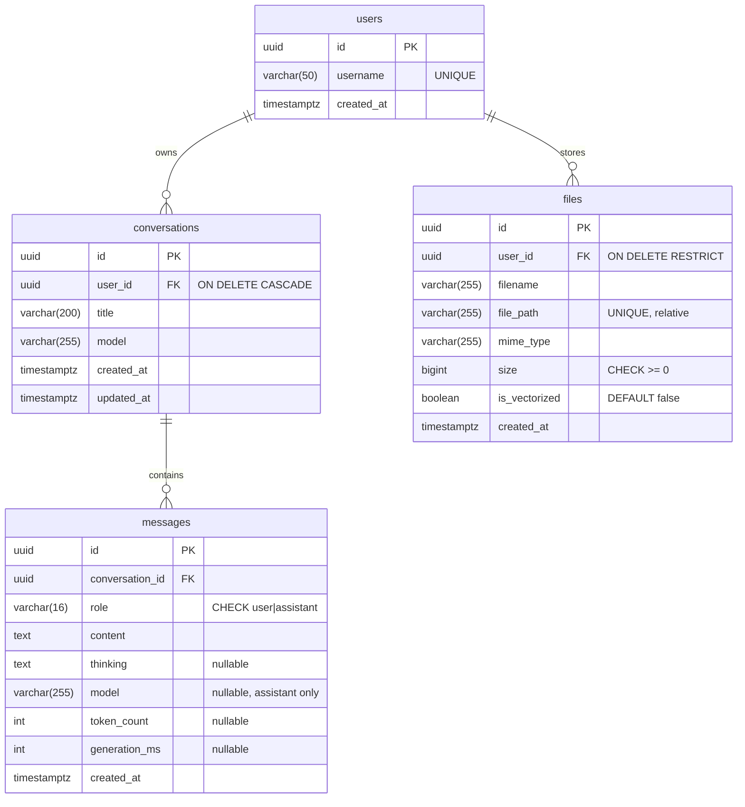

# Database design

Nuage Libre stores its data in **PostgreSQL 18** (container `nuage-postgres`,
image `pgvector/pgvector:pg18`). This document follows the classic design steps:
business rules → conceptual model (MCD) → logical model (MLD) → physical model
(MPD / SQL), then covers access rights, migrations and verification.

## 1. Business rules

| # | Rule |
|---|---|
| R1 | A conversation has a title, a model name, a creation date and a last-update date. |
| R2 | A conversation contains zero or more messages. |
| R3 | A message belongs to exactly one conversation. |
| R4 | A message is written either by the user or by the assistant (nothing else). |
| R5 | An assistant message may store the model's reasoning and generation statistics. |
| R6 | Deleting a conversation deletes all its messages. |
| R7 | A question and its answer are always saved together (never one without the other). |
| R8 | Each answer records the model that produced it; a conversation can mix several models and remembers the latest one. |
| R9 | A user has a unique username. Until authentication exists, a single user, the "Ghost User", owns all the data. |
| R10 | A conversation belongs to exactly one user; a user owns zero or more conversations. Deleting a user deletes their conversations (and their messages). |
| R11 | A file belongs to exactly one user; a user owns zero or more files. |
| R12 | A user who still owns files cannot be deleted (their bytes on disk must be removed first). |
| R13 | A file has a display name, a type, a size (≥ 0) and a storage location *relative* to the storage folder; two files never share a location. |
| R14 | A file is either only stored in the cloud, or also indexed in the AI memory (`is_vectorized`); uploading only stores it. |

## 2. Conceptual data model (MCD, Merise)

```
┌────────────────┐                ┌────────────────────┐                ┌────────────────────┐
│      USER      │      OWNS      │   CONVERSATION     │    CONTAINS    │      MESSAGE       │
├────────────────┤ 0,n ───── 1,1  ├────────────────────┤ 0,n ───── 1,1  ├────────────────────┤
│ id             │                │ id                 │                │ id                 │
│ username       │                │ title              │                │ role               │
│ created_at     │                │ model              │                │ content            │
└────────────────┘                │ created_at         │                │ thinking           │
        │ 0,n                     │ updated_at         │                │ model              │
        │                         └────────────────────┘                │ token_count        │
        │ STORES                                                        │ generation_ms      │
        │ 1,1                                                           │ created_at         │
┌────────────────┐                                                      └────────────────────┘
│      FILE      │
├────────────────┤
│ id             │
│ filename       │
│ file_path      │
│ mime_type      │
│ size           │
│ is_vectorized  │
│ created_at     │
└────────────────┘
```

Cardinalities: a user *owns* 0..n conversations and *stores* 0..n files (R10,
R11); a conversation or a file belongs to exactly 1 user. A conversation
*contains* 0..n messages (R2); a message is *contained in* exactly 1
conversation (R3).

## 3. Logical data model (MLD)

Each 1,1 – 0,n association becomes a foreign key on the "1,1" side:

- **users** (<u>id</u>, username, created_at)
- **conversations** (<u>id</u>, #user_id, title, model, created_at, updated_at)
- **messages** (<u>id</u>, #conversation_id, role, content, thinking, model, token_count, generation_ms, created_at)
- **files** (<u>id</u>, #user_id, filename, file_path, mime_type, size, is_vectorized, created_at)



## 4. Physical data model (MPD)

SQL generated from the Alembic migrations with `alembic upgrade head --sql`
(the migration files in `migrations/versions/` are the source of truth). Final
schema after the four migrations:

```sql
CREATE TABLE users (
    id          UUID                     DEFAULT gen_random_uuid() NOT NULL,
    username    VARCHAR(50)              NOT NULL,
    created_at  TIMESTAMP WITH TIME ZONE DEFAULT now() NOT NULL,
    PRIMARY KEY (id),
    CONSTRAINT uq_users_username UNIQUE (username)
);
-- Seeded by the migration: the Ghost User (see app/auth.py)
INSERT INTO users (id, username) VALUES ('a644871e-8417-4565-91f6-0813f368ff3c', 'ghost');

CREATE TABLE conversations (
    id          UUID                     DEFAULT gen_random_uuid() NOT NULL,
    title       VARCHAR(200)             NOT NULL,
    model       VARCHAR(255)             NOT NULL,
    created_at  TIMESTAMP WITH TIME ZONE DEFAULT now() NOT NULL,
    updated_at  TIMESTAMP WITH TIME ZONE DEFAULT now() NOT NULL,
    user_id     UUID                     NOT NULL,
    PRIMARY KEY (id),
    CONSTRAINT fk_conversations_user_id_users FOREIGN KEY (user_id) REFERENCES users (id) ON DELETE CASCADE
);
CREATE INDEX ix_conversations_user_id_updated_at ON conversations (user_id, updated_at);

CREATE TABLE messages (
    id               UUID                     DEFAULT gen_random_uuid() NOT NULL,
    conversation_id  UUID                     NOT NULL,
    role             VARCHAR(16)              NOT NULL,
    content          TEXT                     NOT NULL,
    thinking         TEXT,
    model            VARCHAR(255),
    token_count      INTEGER,
    generation_ms    INTEGER,
    created_at       TIMESTAMP WITH TIME ZONE DEFAULT now() NOT NULL,
    PRIMARY KEY (id),
    CONSTRAINT ck_messages_role CHECK (role IN ('user', 'assistant')),
    FOREIGN KEY (conversation_id) REFERENCES conversations (id) ON DELETE CASCADE
);
CREATE INDEX ix_messages_conversation_id_created_at ON messages (conversation_id, created_at);

CREATE TABLE files (
    id             UUID                     DEFAULT gen_random_uuid() NOT NULL,
    user_id        UUID                     NOT NULL,
    filename       VARCHAR(255)             NOT NULL,
    file_path      VARCHAR(255)             NOT NULL,
    mime_type      VARCHAR(255)             NOT NULL,
    size           BIGINT                   NOT NULL,
    is_vectorized  BOOLEAN                  DEFAULT false NOT NULL,
    created_at     TIMESTAMP WITH TIME ZONE DEFAULT now() NOT NULL,
    PRIMARY KEY (id),
    CONSTRAINT fk_files_user_id_users FOREIGN KEY (user_id) REFERENCES users (id) ON DELETE RESTRICT,
    CONSTRAINT uq_files_file_path UNIQUE (file_path),
    CONSTRAINT ck_files_path_relative CHECK (left(file_path, 1) <> '/' AND strpos(file_path, '..') = 0),
    CONSTRAINT ck_files_size_not_negative CHECK (size >= 0),
    CONSTRAINT ck_files_filename_not_empty CHECK (filename <> '')
);
CREATE INDEX ix_files_user_id_created_at ON files (user_id, created_at);
```

### Type and constraint choices

| Choice | Reason |
|---|---|
| `UUID` primary keys, `gen_random_uuid()` | Not guessable when exposed in URLs (built into PostgreSQL ≥ 13) |
| `TIMESTAMP WITH TIME ZONE` | Stored in UTC; displayed correctly whatever the device's time zone |
| `VARCHAR(200)` title | Bounded: titles are generated (≤ 60 chars) but the column protects against abuse |
| `TEXT` content / thinking | Answers can be very long; PostgreSQL `TEXT` has no performance penalty vs `VARCHAR` |
| `CHECK (role IN …)` | Enforces R4 in the database itself, whatever the client |
| `FOREIGN KEY … ON DELETE CASCADE` | Enforces R3 (no orphan message) and R6 |
| Index `(user_id, updated_at)` | The sidebar query `WHERE user_id = ? ORDER BY updated_at DESC LIMIT 50` reads the index instead of sorting the table; `user_id` first also serves the FK check when a user is deleted (PostgreSQL does not index foreign keys by itself) |
| Index `(conversation_id, created_at)` | "Messages of one conversation in order" is answered directly by the index |
| `user_id NOT NULL` **without default** | "Fail closed": a row whose owner was forgotten is refused (R10, R11), never silently given to the Ghost User |
| `conversations.user_id` `ON DELETE CASCADE` | Enforces R10 (right to erasure: conversations and, by the existing cascade, messages) |
| `files.user_id` `ON DELETE RESTRICT` | Enforces R12: a row describes bytes on disk that PostgreSQL cannot delete; a cascade would lose track of them |
| `UNIQUE (username)` | Enforces R9 |
| `files.file_path` relative + `UNIQUE` + `CHECK` (no leading `/`, no `..`) | Enforces R13; a row can never designate a file outside the storage folder (path traversal defence in the database itself) |
| `BIGINT size` | A 32-bit `INTEGER` overflows at 2 GiB, the default upload limit |
| `is_vectorized BOOLEAN DEFAULT false` | Enforces R14 |
| Index `(user_id, created_at)` on `files` | "Files of user X, newest first" answered by the index |

R7 (question + answer saved together) is enforced by the application with a
single transaction, see `docs/ARCHITECTURE.md` §4.3. The consistency between a
`files` row and its bytes on disk is enforced by the order of operations (disk
first, row last, compensating delete), see `docs/CLOUD_STORAGE.md` §5.2.

## 5. Roles and access rights (least privilege)

Created by `db/init/01-create-roles.sh` the first time the container starts.

| Role | Used by | Rights |
|---|---|---|
| `postgres` | Container administration only | Superuser |
| `nuage_owner` | Alembic migrations | Owns `nuage_libre` and `nuage_libre_test`; can CREATE / ALTER / DROP tables |
| `nuage_app` | The running FastAPI application | `CONNECT`; `SELECT, INSERT, UPDATE, DELETE` on tables. **Cannot** create, alter or drop anything |

- `REVOKE ALL ON DATABASE … FROM PUBLIC`: no other role can even connect.
- `REVOKE CREATE ON SCHEMA public FROM PUBLIC`: the app cannot create objects.
- `ALTER DEFAULT PRIVILEGES FOR ROLE nuage_owner …`: every table created later by
  a migration automatically grants the DML rights to `nuage_app`.

Resulting privileges (`\dp`), `arwd` = INSERT (a), SELECT (r), UPDATE (w), DELETE (d).
The two tables added in v0.5 received exactly the same rights automatically,
thanks to the default privileges (verified on the real database on 2026-11-12):

```
 conversations | nuage_owner=arwdDxtm/nuage_owner  nuage_app=arwd/nuage_owner
 files         | nuage_owner=arwdDxtm/nuage_owner  nuage_app=arwd/nuage_owner
 messages      | nuage_owner=arwdDxtm/nuage_owner  nuage_app=arwd/nuage_owner
 users         | nuage_owner=arwdDxtm/nuage_owner  nuage_app=arwd/nuage_owner
```

### Verification (performed on 2026-11-09)

Connected as `nuage_app`:

```
nuage_libre=> INSERT INTO conversations(title, model) VALUES ('t','m') RETURNING id;
 96c63e70-c1fb-4968-8ca0-108b1c294767                       -- allowed ✅

nuage_libre=> DROP TABLE messages;
ERROR:  must be owner of table messages                     -- refused ✅

nuage_libre=> CREATE TABLE pirate(x int);
ERROR:  permission denied for schema public                 -- refused ✅

nuage_libre=> INSERT INTO messages(conversation_id, role, content)
              VALUES (gen_random_uuid(), 'hacker', 'x');
ERROR:  new row for relation "messages" violates check constraint "ck_messages_role"  ✅
```

### Verification of the v0.5 tables (performed on 2026-11-12, test database)

Connected as `nuage_app`:

```
DROP TABLE files;
ERROR:  must be owner of table files                                          ✅
ALTER TABLE users ADD COLUMN is_admin boolean;
ERROR:  must be owner of table users                                          ✅
INSERT INTO files (user_id, filename, file_path, mime_type, size)
       VALUES ('a644871e-…', 'x', '/etc/shadow', 'text/plain', 1);
ERROR:  new row for relation "files" violates check constraint "ck_files_path_relative"  ✅
INSERT INTO files (…, file_path, …) VALUES (…, 'a/../../etc/shadow', …);
ERROR:  new row for relation "files" violates check constraint "ck_files_path_relative"  ✅
INSERT INTO conversations (title, model) VALUES ('t', 'm');
ERROR:  null value in column "user_id" of relation "conversations" violates not-null constraint  ✅
```

### Network exposure

The container publishes port 5432 on `127.0.0.1` only (`compose.yaml`): the
database is reachable by the application on the same machine, but not from the
local network nor from Tailscale peers.

## 6. Migrations (Alembic)

The schema is versioned like code. Each change is a Python file in
`migrations/versions/` with an `upgrade()` and a `downgrade()` function; Alembic
records the applied version in the `alembic_version` table.

```bash
venv/bin/alembic upgrade head                 # apply all pending migrations
venv/bin/alembic downgrade -1                 # revert the last one
venv/bin/alembic history                      # list migrations
venv/bin/alembic upgrade head --sql           # print the SQL without running it
# After editing app/models.py:
venv/bin/alembic revision --autogenerate -m "add users table"
```

### Migration history

| Revision | Date | Change | Type |
|---|---|---|---|
| `f7179d8256ea` | 2026-11-09 | Create `conversations` and `messages` | Schema |
| `902d09722b60` | 2026-11-09 | Add `messages.model` + backfill existing answers from `conversations.model` | Schema + **data** migration |
| `c3e9a1d4b7f2` | 2026-11-12 | Create `users` + seed the Ghost User; add `conversations.user_id` (nullable → backfill → NOT NULL → FK); replace the `updated_at` index by `(user_id, updated_at)` | Schema + **data** migration |
| `d8f2b6e1a5c4` | 2026-11-12 | Create `files` (FK RESTRICT, UNIQUE path, CHECK constraints, index) | Schema |

The second migration shows the two kinds of migration: `ADD COLUMN` changes the
structure, and an `UPDATE … FROM` join fills the new column for rows that already
existed, so no old answer is left without a model. Applied to the real database on
2026-11-09:

```
 role      | model is null | count
-----------+---------------+-------
 assistant | f             |     7     -- every existing answer got its model
 user      | t             |     7     -- user messages: NULL by design
```

The migration was also tested for reversibility (`alembic downgrade -1` then
`alembic upgrade head`).

**`c3e9a1d4b7f2`: why the autogenerated script had to be rewritten.**
`alembic revision --autogenerate` produced
`add_column('conversations', Column('user_id', nullable=False))`. That runs on
an empty test database but **fails on the real one**: PostgreSQL cannot add a
NOT NULL column to a table that already has rows (they would have no value).
The script was rewritten with the standard three steps: add the column as
nullable, backfill it (every existing conversation → Ghost User), then set
NOT NULL and add the foreign key; all in one transaction. It also seeds the
Ghost User with `op.bulk_insert` (parameterised), and freezes its UUID as a
literal instead of importing it from the application (a migration must replay
identically forever; test T-USER-01 checks both values are still equal).

Tested before touching real data: a "legacy" conversation was inserted in the
test database, the migration applied, and the conversation was found owned by
the Ghost User. Then applied to the real database on 2026-11-12, after a
`pg_dump` backup:

```
 username | conversations          conversations_without_owner      messages
----------+---------------         ----------------------------     --------
 ghost    |            13                                     0           38
```

Reversibility of both v0.5 migrations: `alembic downgrade -2` (only
`conversations` and `messages` remain, as in v0.4), then `alembic upgrade head`,
then `alembic check` → "No new upgrade operations detected" (models and
migrations in sync).

Migrations run with the `nuage_owner` role (`NUAGE_MIGRATION_DATABASE_URL`);
PostgreSQL's transactional DDL means a failing migration is fully rolled back.

## 7. Backup and restore

```bash
# Backup (custom compressed format)
podman exec nuage-postgres pg_dump -U postgres -Fc nuage_libre > backup_$(date +%F).dump
# Restore into an empty database
podman exec -i nuage-postgres pg_restore -U postgres -d nuage_libre --clean < backup_2026-11-09.dump
```

Data itself lives in the named volume `nuage-pgdata`, which survives container
re-creation and image upgrades.

The files of the private cloud are **not** in the database: back up the storage
folder too (`NUAGE_STORAGE_DIR`), right after the dump, see
`docs/CLOUD_STORAGE.md` §9.

## 8. Next evolutions

- **v0.6 – authentication**: add `password_hash` (Argon2) and possibly `email`
  to `users`. `conversations` and `files` do not change: they already reference
  `users` (Ghost User strategy, `docs/CLOUD_STORAGE.md` §2.3).
- **v0.7 – RAG**: `document_chunks (id, file_id → files.id ON DELETE CASCADE,
  chunk_index, content, embedding VECTOR(768))` with an HNSW index for similarity
  search (pgvector); `files.is_vectorized` set to true once a file is indexed.
