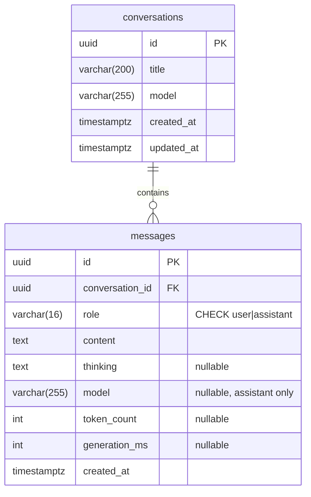

# Database design

Nuage Libre stores its data in **PostgreSQL 18** (container `nuage-postgres`,
image `pgvector/pgvector:pg18`). This document follows the classic design steps:
business rules → conceptual model (MCD) → logical model (MLD) → physical model
(MPD / SQL), then covers access rights, migrations and verification.

## 1. Business rules

| # | Rule |
|---|---|
| R1 | A conversation has a title, a model name, a creation date and a last-update date. |
| R2 | A conversation contains zero or more messages. |
| R3 | A message belongs to exactly one conversation. |
| R4 | A message is written either by the user or by the assistant (nothing else). |
| R5 | An assistant message may store the model's reasoning and generation statistics. |
| R6 | Deleting a conversation deletes all its messages. |
| R7 | A question and its answer are always saved together (never one without the other). |
| R8 | Each answer records the model that produced it; a conversation can mix several models and remembers the latest one. |

## 2. Conceptual data model (MCD, Merise)

```
┌────────────────────┐                         ┌────────────────────┐
│   CONVERSATION     │                         │      MESSAGE       │
├────────────────────┤        CONTAINS         ├────────────────────┤
│ id                 │ 0,n ───────────── 1,1   │ id                 │
│ title              │                         │ role               │
│ model              │                         │ content            │
│ created_at         │                         │ thinking           │
│                    │                         │ model              │
│ updated_at         │                         │ token_count        │
└────────────────────┘                         │ generation_ms      │
                                               │ created_at         │
                                               └────────────────────┘
```

Cardinalities: a conversation *contains* 0..n messages (R2); a message is
*contained in* exactly 1 conversation (R3).

## 3. Logical data model (MLD)

The 1,1 – 0,n association becomes a foreign key on the "1,1" side:

- **conversations** (<u>id</u>, title, model, created_at, updated_at)
- **messages** (<u>id</u>, #conversation_id, role, content, thinking, model, token_count, generation_ms, created_at)



## 4. Physical data model (MPD)

SQL generated from the Alembic migrations with `alembic upgrade head --sql`
(the migration files in `migrations/versions/` are the source of truth). Final
schema after both migrations:

```sql
CREATE TABLE conversations (
    id          UUID                     DEFAULT gen_random_uuid() NOT NULL,
    title       VARCHAR(200)             NOT NULL,
    model       VARCHAR(255)             NOT NULL,
    created_at  TIMESTAMP WITH TIME ZONE DEFAULT now() NOT NULL,
    updated_at  TIMESTAMP WITH TIME ZONE DEFAULT now() NOT NULL,
    PRIMARY KEY (id)
);
CREATE INDEX ix_conversations_updated_at ON conversations (updated_at);

CREATE TABLE messages (
    id               UUID                     DEFAULT gen_random_uuid() NOT NULL,
    conversation_id  UUID                     NOT NULL,
    role             VARCHAR(16)              NOT NULL,
    content          TEXT                     NOT NULL,
    thinking         TEXT,
    model            VARCHAR(255),
    token_count      INTEGER,
    generation_ms    INTEGER,
    created_at       TIMESTAMP WITH TIME ZONE DEFAULT now() NOT NULL,
    PRIMARY KEY (id),
    CONSTRAINT ck_messages_role CHECK (role IN ('user', 'assistant')),
    FOREIGN KEY (conversation_id) REFERENCES conversations (id) ON DELETE CASCADE
);
CREATE INDEX ix_messages_conversation_id_created_at ON messages (conversation_id, created_at);
```

### Type and constraint choices

| Choice | Reason |
|---|---|
| `UUID` primary keys, `gen_random_uuid()` | Not guessable when exposed in URLs (built into PostgreSQL ≥ 13) |
| `TIMESTAMP WITH TIME ZONE` | Stored in UTC; displayed correctly whatever the device's time zone |
| `VARCHAR(200)` title | Bounded: titles are generated (≤ 60 chars) but the column protects against abuse |
| `TEXT` content / thinking | Answers can be very long; PostgreSQL `TEXT` has no performance penalty vs `VARCHAR` |
| `CHECK (role IN …)` | Enforces R4 in the database itself, whatever the client |
| `FOREIGN KEY … ON DELETE CASCADE` | Enforces R3 (no orphan message) and R6 |
| Index `(updated_at)` | The sidebar query `ORDER BY updated_at DESC LIMIT 50` reads the index instead of sorting the table |
| Index `(conversation_id, created_at)` | "Messages of one conversation in order" is answered directly by the index |

R7 (question + answer saved together) is enforced by the application with a
single transaction, see `docs/ARCHITECTURE.md` §4.3.

## 5. Roles and access rights (least privilege)

Created by `db/init/01-create-roles.sh` the first time the container starts.

| Role | Used by | Rights |
|---|---|---|
| `postgres` | Container administration only | Superuser |
| `nuage_owner` | Alembic migrations | Owns `nuage_libre` and `nuage_libre_test`; can CREATE / ALTER / DROP tables |
| `nuage_app` | The running FastAPI application | `CONNECT`; `SELECT, INSERT, UPDATE, DELETE` on tables. **Cannot** create, alter or drop anything |

- `REVOKE ALL ON DATABASE … FROM PUBLIC`: no other role can even connect.
- `REVOKE CREATE ON SCHEMA public FROM PUBLIC`: the app cannot create objects.
- `ALTER DEFAULT PRIVILEGES FOR ROLE nuage_owner …`: every table created later by
  a migration automatically grants the DML rights to `nuage_app`.

Resulting privileges (`\dp`), `arwd` = INSERT (a), SELECT (r), UPDATE (w), DELETE (d):

```
 conversations | nuage_owner=arwdDxtm/nuage_owner  nuage_app=arwd/nuage_owner
 messages      | nuage_owner=arwdDxtm/nuage_owner  nuage_app=arwd/nuage_owner
```

### Verification (performed on 2026-11-09)

Connected as `nuage_app`:

```
nuage_libre=> INSERT INTO conversations(title, model) VALUES ('t','m') RETURNING id;
 96c63e70-c1fb-4968-8ca0-108b1c294767                       -- allowed ✅

nuage_libre=> DROP TABLE messages;
ERROR:  must be owner of table messages                     -- refused ✅

nuage_libre=> CREATE TABLE pirate(x int);
ERROR:  permission denied for schema public                 -- refused ✅

nuage_libre=> INSERT INTO messages(conversation_id, role, content)
              VALUES (gen_random_uuid(), 'hacker', 'x');
ERROR:  new row for relation "messages" violates check constraint "ck_messages_role"  ✅
```

### Network exposure

The container publishes port 5432 on `127.0.0.1` only (`compose.yaml`): the
database is reachable by the application on the same machine, but not from the
local network nor from Tailscale peers.

## 6. Migrations (Alembic)

The schema is versioned like code. Each change is a Python file in
`migrations/versions/` with an `upgrade()` and a `downgrade()` function; Alembic
records the applied version in the `alembic_version` table.

```bash
venv/bin/alembic upgrade head                 # apply all pending migrations
venv/bin/alembic downgrade -1                 # revert the last one
venv/bin/alembic history                      # list migrations
venv/bin/alembic upgrade head --sql           # print the SQL without running it
# After editing app/models.py:
venv/bin/alembic revision --autogenerate -m "add users table"
```

### Migration history

| Revision | Date | Change | Type |
|---|---|---|---|
| `f7179d8256ea` | 2026-11-09 | Create `conversations` and `messages` | Schema |
| `902d09722b60` | 2026-11-09 | Add `messages.model` + backfill existing answers from `conversations.model` | Schema + **data** migration |

The second migration shows the two kinds of migration: `ADD COLUMN` changes the
structure, and an `UPDATE … FROM` join fills the new column for rows that already
existed, so no old answer is left without a model. Applied to the real database on
2026-11-09:

```
 role      | model is null | count
-----------+---------------+-------
 assistant | f             |     7     -- every existing answer got its model
 user      | t             |     7     -- user messages: NULL by design
```

The migration was also tested for reversibility (`alembic downgrade -1` then
`alembic upgrade head`).

Migrations run with the `nuage_owner` role (`NUAGE_MIGRATION_DATABASE_URL`);
PostgreSQL's transactional DDL means a failing migration is fully rolled back.

## 7. Backup and restore

```bash
# Backup (custom compressed format)
podman exec nuage-postgres pg_dump -U postgres -Fc nuage_libre > backup_$(date +%F).dump
# Restore into an empty database
podman exec -i nuage-postgres pg_restore -U postgres -d nuage_libre --clean < backup_2026-11-09.dump
```

Data itself lives in the named volume `nuage-pgdata`, which survives container
re-creation and image upgrades.

## 8. Next evolutions

- **v0.5 – users**: `users (id, username UNIQUE, password_hash, created_at)` and
  `conversations.user_id` FK, so each user only sees their own conversations.
- **v0.6 – RAG**: `documents (id, user_id, filename, mime_type, size, uploaded_at)`
  and `document_chunks (id, document_id, content, embedding VECTOR(768))` with an
  HNSW index for similarity search (pgvector).
